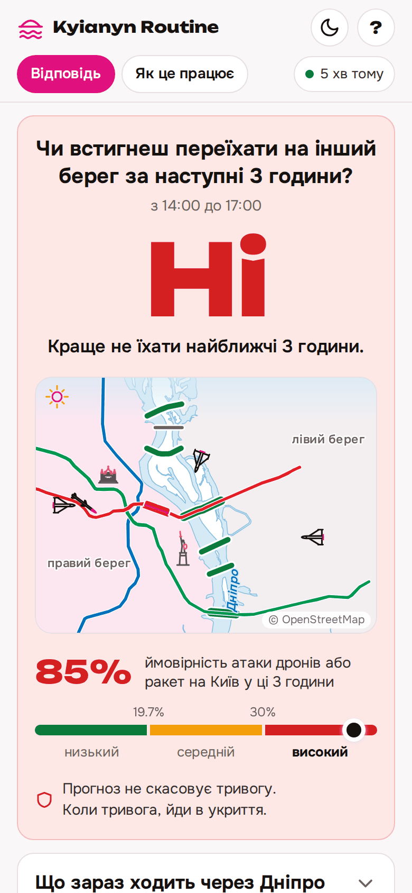
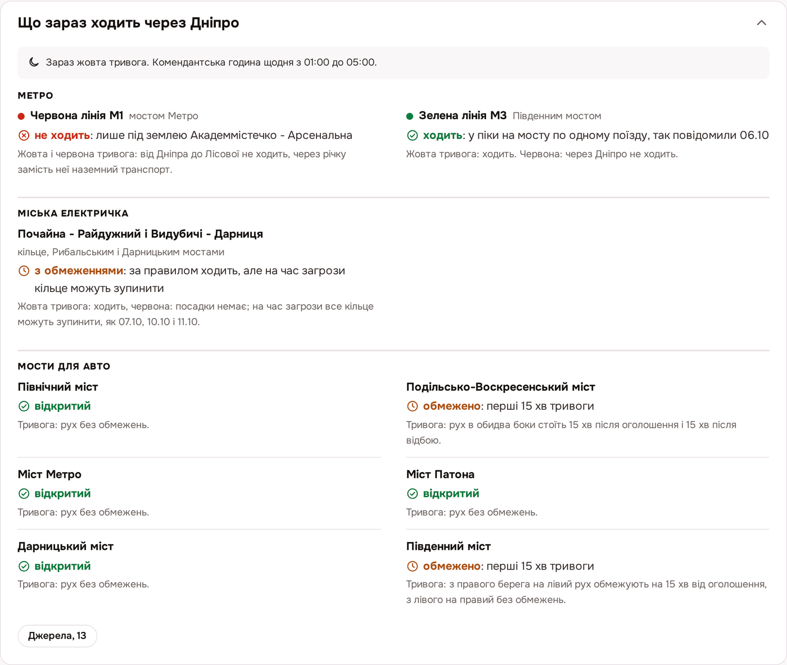
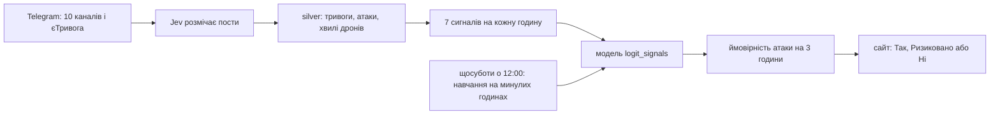
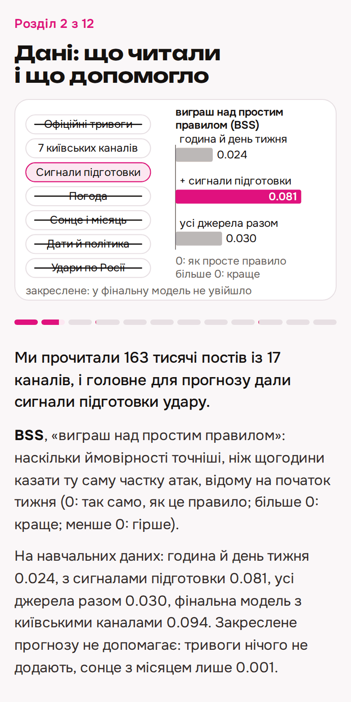
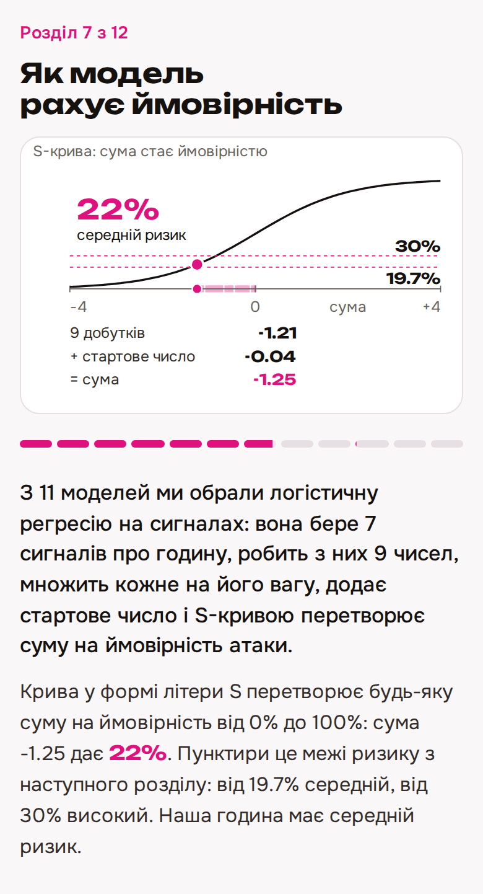
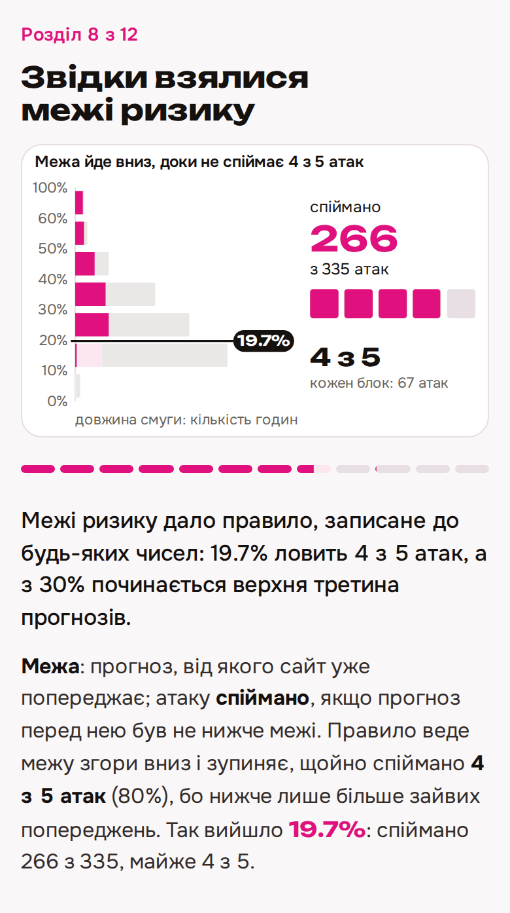
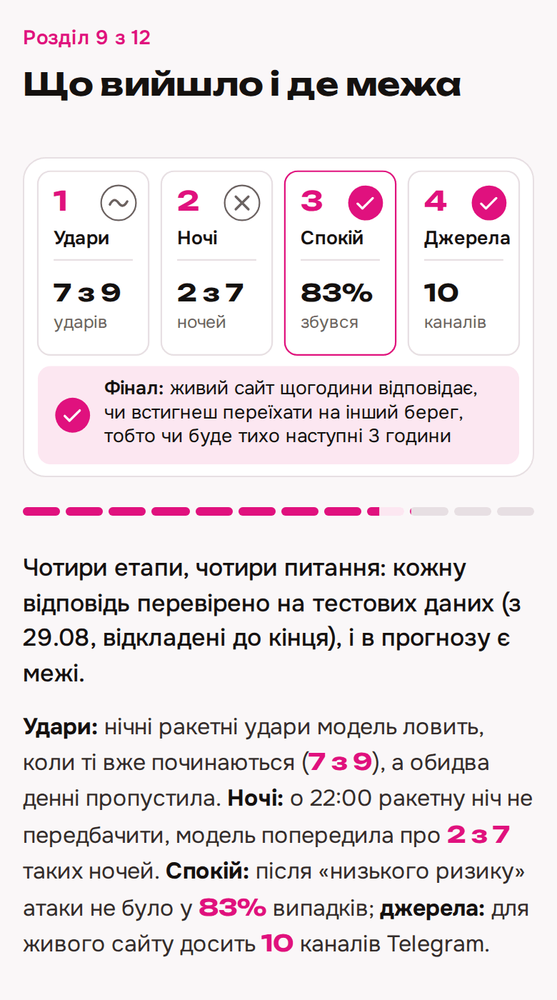

# Kyianyn Routine: чи встигнеш переїхати на інший берег за 3 години

Сайт щогодини відповідає киянам «Так», «Ризиковано» або «Ні» на питання: чи встигнеш переїхати на інший берег Дніпра, поки в наступні 3 години на Київ не полетять дрони чи ракети. Для суддів KSE AI Agentic School тут увесь шлях проєкту, зробленого разом з Claude Code: дані, модель, сайт і чати з ШІ.

**[Відкрити сайт](https://kyianyn-routine.isakov.fyi)** | [Як це працює](https://kyianyn-routine.isakov.fyi/#/how) (презентація, 12 розділів) | [Чати з ШІ](chats/README.md) | [Завдання](docs/ASSIGNMENT.md)

<p>
  
  
</p>

## Суть за хвилину

- **Питання.** Чи встигнеш переїхати на інший берег за наступні 3 години. Під час будь-якої тривоги червона лінія метро не їде через Дніпро, а за червоного рівня тривоги не їде і зелена ([crossing.md](docs/product/crossing.md)). Тому сайт прогнозує атаку на Київ у наступні 3 години: дрони летять на Київ або вибухають у ньому, ракетна загроза Києву або ракетний удар.
- **Дані.** 163 042 пости з 17 публічних каналів Telegram з 16.04.2026 і тривоги КМВА. Пости розмітила мовна модель Jev: чи пише пост про дрони чи ракети на Київ, чи готують удар (36 006 викликів, $9.06). Для живого сайту лишилось 10 каналів і єТривога.
- **Модель.** Логістична регресія на 7 сигналах про годину: хвилі дронів з курсом на Київ, скільки годин минуло від атаки, година доби та інші. Кожен сигнал має свою вагу, а зважена сума стає ймовірністю від 0 до 100%. Її обрало правило, записане до будь-яких чисел, серед 11 моделей ([таблиця порівняння](reports/quiet_leaderboard.md)).
- **Чесний результат.** Модель вчилась на годинах з 01.05 до 29.08.2026 (навчальні дані), а перевірена на 6 тижнях з 29.08 до 10.10, які до кінця лежали закриті (тестові дані). Після «низький ризик» атаки не було у 83% випадків і на навчальних, і на тестових даних; після «високий ризик» атака була у 49% і 80%. BSS на тестових даних 0.284: помилка ймовірностей на 28% менша, ніж у простого правила «щогодини казати ту саму частку атак, відому на початок тижня».
- **Чого не вміє.** Тишу не гарантує: після «низький ризик» приблизно 1 раз з 6 таки прилітає. Масовану ракетну атаку від дронів майже не відрізняє. Восени атак стало більше, і на тестових даних модель назвала «високим ризиком» 322 з 412 тихих годин (тривоги немає, атаки в минулу годину не було). Відповідь сайту не дозвіл виходити з укриття під час тривоги.
- **Наживо і без підглядання в майбутнє.** Сайт перевіряє канали кожні 5 хвилин, ймовірність рахує щогодини, модель перенавчає щосуботи о 12:00 за Києвом. 92 тести; головний бере 50 випадкових моментів і звіряє 2400 чисел, які бачить модель, з порахованими лише з минулого: 0 розбіжностей.

## Як це працює



1. Кожні 5 хвилин сайт забирає нові пости 10 каналів Telegram з публічних сторінок `t.me/s`; єТривогу читає лише для того, щоб не пропустити початок тривоги.
2. Jev, мовна модель для розмітки тексту, відповідає на кожен пост: чи летять дрони чи ракети на Київ, чи готують удар (хвилі дронів, зліт стратегічної авіації). Тривоги КМВА читає простий шаблон тексту, без мовної моделі.
3. Дані йдуть трьома рівнями: bronze (сирі пости як є), silver (таблиці подій, у кожного рядка час, коли він став відомим), gold (рядок на годину з сигналами, порахованими лише з минулого).
4. Модель множить кожен сигнал на його вагу і перетворює суму на ймовірність S-кривою. 7 сигналів стають 9 числами: годину доби записано трьома ([model.md](docs/quiet/model.md)).
5. Межі ризику: нижче 19.7% низький (сайт каже «Так»), від 30% високий («Ні»), між ними «Ризиковано». Їх не обирали руками: правило, записане до чисел, на навчальних даних дало 19.7%, бо ця межа ловить 4 з 5 атак, і 30%, бо звідти починається верхня третина всіх прогнозів ([forecast.md](docs/quiet/forecast.md)).
6. Щосуботи о 12:00 модель заново вчиться на всіх годинах, чиї 3 години вже минули ([ADR-0013](docs/adr/0013-retrain-cadence.md)).

<table>
  <tr>
    <td><br>Розділ 2. Дані: 163 тисячі постів із 17 каналів, головне для прогнозу дали сигнали підготовки удару.</td>
    <td><br>Розділ 7. Як модель рахує ймовірність: 7 сигналів, 9 чисел, ваги і S-крива.</td>
  </tr>
  <tr>
    <td><br>Розділ 8. Звідки межі ризику: правило, записане до чисел; 19.7% ловить 4 з 5 атак.</td>
    <td><br>Розділ 9. Що вийшло: чотири етапи, чотири питання, кожну відповідь перевірено на тестових даних.</td>
  </tr>
</table>

## Як ми працювали з ШІ

Увесь проєкт зроблено в Claude Code за 7 сесій, з 10 по 12 жовтня 2026. Головний агент (Claude Opus) ділив роботу на шматки: кожен шматок будував окремий агент, а приймав свіжий агент, який лише читав. Він починав з «не пройдено», сам запускав перевірки, підкладав вхід, на якому перевірка мусить впасти, і читав рядки вручну. Моделі шукали 4 агенти-дослідники, 2 судді і 3 скептики ([ADR-0009](docs/adr/0009-three-models.md)), дані перед моделюванням перевіряли 5 агентів аудиту ([ADR-0007](docs/adr/0007-audit-before-modelling.md)), сигнали підготовки удару перечитали 309 агентів Haiku ([HISTORY.md](docs/HISTORY.md#журнал-запусків)). Автор ставив питання, ухвалював рішення і сумнівався в результатах.

**Чати.** Повний експорт без секретів ([ADR-0014](docs/adr/0014-chats-publication.md)), як читати: [chats/README.md](chats/README.md), усі підряд: [all-chats.md](chats/all-chats.md). У перших шести сесіях 109 повідомлень автора.

1. [Чат 01](chats/01-2026-10-10-assignment-and-data-plan.md), 10.10: завдання і план даних; 29 повідомлень автора.
2. [Чат 02](chats/02-2026-10-10-data-collection-bronze-silver-gold.md), 10.10..11.10: збір даних, рівні bronze, silver, gold; 13 повідомлень.
3. [Чат 03](chats/03-2026-10-11-cleanup-and-signal-check.md), 11.10: прибирання, перевірка мітки ударів і сигналів; 16 повідомлень.
4. [Чат 04](chats/04-2026-10-11-data-audit-before-modelling.md), 11.10: аудит даних перед моделюванням; 3 повідомлення.
5. [Чат 05](chats/05-2026-10-11-modelling.md), 11.10: моделювання, чотири етапи; 30 повідомлень.
6. [Чат 06](chats/06-2026-10-11-live-site-and-deck.md), 11.10..12.10: живий сайт і презентація; 18 повідомлень.
7. [Чат 07](chats/07-2026-10-12-final-polish-and-publish.md), 12.10: фінальне шліфування і публікація; 1 повідомлення, голосова нотатка з усіма правками після перегляду сайту з телефона.

**Де автор зупинив або виправив ШІ.**

1. **Ціль, яку ШІ вигадав.** Автор спитав, звідки взялась ціль прогнозу. Claude визнав: «Цю ціль я вигадав сам, у завданні її немає». Далі ціль обирав автор: спершу ракетний удар по Києву, згодом будь-яка атака, з дронами теж ([чат 01](chats/01-2026-10-10-assignment-and-data-plan.md), 10.10 16:00).
2. **Мітка ударів.** Мітка (позначка, у які години по Києву був ракетний удар) дала 77 годин удару за 36 днів, автор відповів: «цьому я не сильно вірю», і попросив звірити з новинами. Агенти наосліп, не бачачи мітки, зібрали два незалежні еталони: 30 з 33 ночей удару підтвердились, ще 2 підтвердили пости, а одну пропущену годину (18.09, «Циркони») і одну зайву (27.08, уламки реактивних дронів) виправили ([чат 03](chats/03-2026-10-11-cleanup-and-signal-check.md), [ADR-0006](docs/adr/0006-external-verification.md)).
3. **Аудит і витік.** Автор попросив не довіряти роботі попереднього агента і перевірити дані зверху вниз: чи немає витоку майбутнього і чи правильно пораховано погодинні числа. Головний агент і 5 агентів лише з читанням знайшли: 15 з 77 годин удару хибні (звіти про наслідки, реактивний дрон), а пости, переписані після публікації, починали події сигналів на 1.3..5.7 години раніше, тобто модель підглядала б у майбутнє. Обидва виправлено ([чат 04](chats/04-2026-10-11-data-audit-before-modelling.md), [ADR-0007](docs/adr/0007-audit-before-modelling.md)).
4. **Поріг руками.** Головний агент попросив автора обрати поріг ризику: 19%, 30% чи 50%. Автор: «...звідки знаю це ми маємо з тесту чи трейну сказати!». Тепер межі дає правило, записане наперед, лише з навчальних даних: 19.7% і 30% ([чат 05](chats/05-2026-10-11-modelling.md), [HISTORY.md, помилка 4](docs/HISTORY.md#помилки-і-як-їх-виправлено)).
5. **Два жахливі слайди.** 12.10 автор пройшов презентацію з телефона і про крок 2 розділу 9 сказав: «просто жахливий слайд», так само про крок 2 розділу 10. Обидва перебудовано: у розділі 9 три рядки з великими числами, у розділі 10 пояснено частку за 7 днів і чому на тестових даних 82%, а не 83% ([чат 07](chats/07-2026-10-12-final-polish-and-publish.md)).

Розділ 12 презентації називає п'ять помилок ШІ, які зловили й виправили: таблиця порівняння показувала тестові дані на кожному запуску; 15 хибних годин удару; переписані пости, що починали події раніше; питання про поріг; тест на витік, що не бачив даних у змінних програми. Повний список з тим, хто зловив і де записано: [HISTORY.md, «Помилки і як їх виправлено»](docs/HISTORY.md#помилки-і-як-їх-виправлено). Рішення автора: [про дані](docs/HISTORY.md#рішення-користувача), [у моделюванні](docs/HISTORY.md#рішення-користувача-в-моделюванні).

## Рефлексія

**Що пішло не так.** Перше питання, ракетний удар у наступні 3 години, мало замало подій: 9 атак на тестових даних, і жодна модель не довела, що краща за просте правило. Нічна модель попередила лише про 2 з 7 ракетних ночей. ШІ помилявся: вигадав ціль, показував тестові числа щоразу, просив обрати поріг руками.

**Як змінили підхід.** Правила вибору записували до чисел, тестові дані відкривали один раз, кожен шматок приймав свіжий агент, мітку звіряли з незалежними джерелами. Питання міняли, коли відповідь не давала людині рішення.

**Чому фінал кращий.** Він відповідає на питання, з яким можна щось зробити; на свіжих даних він так само чесний, як на старих (після «низький ризик» тихо у 83% випадків на обох наборах); і працює наживо.

## Як запустити

Linux, Python 3.11 або новіший (перевірено на 3.14.4). Версії пакетів зафіксовано в [pyproject.toml](pyproject.toml).

```
git clone https://github.com/yegqr/kyianyn-routine
cd kyianyn-routine
python3 -m venv .venv
.venv/bin/pip install -e .
```

Усі команди з кореня репозиторію. Час виміряно 2026-10-11 на цій машині, тести 2026-10-12.

| Що | Команда | Час |
|---|---|---|
| тести (92) | `choom -n 500 -- .venv/bin/python -I -m unittest discover -s tests` | 79 с |
| поділ на навчальні і тестові дані | `.venv/bin/python -I -m airalerts.evaluation.split` | менше 1 с |
| моделі ударів | `.venv/bin/python -I -m airalerts.strikes.<naive\|share_table\|logistic\|lgbm>` | до 4 с кожна |
| моделі ночей | `.venv/bin/python -I -m airalerts.nights.<rules\|stats\|ml>` | до 13 с |
| моделі спокою | `.venv/bin/python -I -m airalerts.quiet.<baselines\|linear\|trees>` | до 21 с |
| оцінювач ударів | `.venv/bin/python -I -m airalerts.strikes.score final` | 36 с |
| оцінювач ночей | `.venv/bin/python -I -m airalerts.nights.score final` | 3 с |
| оцінювач спокою | `.venv/bin/python -I -m airalerts.quiet.score final` | 57 с |
| прогноз для людини | `.venv/bin/python -I -m airalerts.quiet.forecast ["YYYY-MM-DD HH:MM" \| day YYYY-MM-DD]` | 1.5 с |

- `choom -n 500 --` лише знижує пріоритет процесу, коли системі бракує пам'яті; без нього команда та сама.
- Спершу моделі пишуть прогнози в `data/predictions/` (не в git), потім оцінювач читає їх і рахує всім однакові мірила.
- `final` рахує і тестові дані; так згенеровано три таблиці в [reports/](reports/), і повтор відтворив їх байт у байт. Без аргументу оцінювач рахує лише навчальні дані і **переписує** таблицю в `reports/`; `check NAME` друкує одну модель проти опорної.
- Таблиці gold лежать у git, silver і bronze ні. Частина тестів (`test_gold_hourly`, `test_nights`) читає silver, тож на чистій копії спершу треба зібрати bronze і silver ([ARCHITECTURE.md](docs/ARCHITECTURE.md), «Як запустити», пункти 1..2). Без кешу відповідей Jev це коштує гроші і дає трохи інші числа ([DATASET.md](docs/data/DATASET.md)).

Приклад прогнозу (`.venv/bin/python -I -m airalerts.quiet.forecast "2026-09-18 17:00"`):

```
Київ, 2026-09-18 17:00: прогноз на 17:00..20:00
  Зараз: тихо.
  Наступні 3 години: швидше неспокійно, високий ризик.
  Ймовірність, що прилетять дрони або ракети: 54%.
  Чому: годин від останньої атаки 1 (+); запуски хвиль дронів за 3 год 10 (+); година доби 17:00 (-).
  Що сталося насправді: неспокійно: дрони, ракети.
```

Живий сайт ([ARCHITECTURE.md](docs/ARCHITECTURE.md), «Живий сайт»; циклу потрібен ключ Jev у змінній `TYPESAFE_API_KEY`):

| Що | Команда | Коли |
|---|---|---|
| створити живі дані | `.venv/bin/python -I -m airalerts.live.datadir init data/live` | один раз |
| цикл | `AIRALERTS_DATA=data/live .venv/bin/python -I -m airalerts.live.cycle --out /var/www/kyianyn-routine` | таймер, кожні 5 хв |
| перенавчання | `AIRALERTS_DATA=data/live .venv/bin/python -I -m airalerts.live.model train` | таймер, субота 12:00 за Києвом |
| живі сигнали проти gold | `.venv/bin/python -I -m airalerts.live.features check` | після зміни коду |
| чати з ШІ | `.venv/bin/python -I scripts/chats/export.py --deny <список приватних слів>` | перед публікацією ([chats/README.md](chats/README.md)) |

## Дані

Лише місто Київ, щоб спершу перевірити ідею на одному місті; з травня 2026, бо після масованого обстрілу 14 травня діє новий режим атак ([METHODOLOGY.md](docs/METHODOLOGY.md), розділи 1..2).

| Джерело | Що дає | Як | Наживо |
|---|---|---|---|
| Telegram КМВА @VA_Kyiv і єТривога | тривоги по Києву, початок і кінець до хвилини | публічна сторінка `t.me/s`, шаблон тексту | так |
| 7 київських каналів (КМВА, Кличко, монітори) | мітки «ракетний удар», «ракетна загроза», «дрони на Київ» за годинами | `t.me/s` і Jev | так |
| 6 моніторингових каналів | сигнали підготовки: стратегічна авіація, МіГ-31К, хвилі ударних дронів | `t.me/s` і Jev | так |
| Open-Meteo, модель ECMWF IFS | прогноз погоди з часом видачі | JSON API | ні |
| власний модуль | сонце і місяць над Києвом | код, без мережі | ні |
| таблиця 100 дат, Kremlin, Вікіпедія, Telegram ОП | символічні дати, візити, саміти, переговори | CSV, HTML, MediaWiki API | ні |
| dronestrikemap.com | удари по Росії і запуски по Україні, день відомий через 30 год | JSON API | ні |

Деталі кожного джерела: [PARSING.md](docs/data/PARSING.md). Чому наживо лише Telegram: погода, політика, дати й удари по Росії прогнозу не допомагають ([sources.md](docs/quiet/sources.md)). Усього 17 каналів, 163 042 пости ([HANDOFF.md](docs/HANDOFF.md)); 36 006 платних викликів Jev, $9.06 ([HISTORY.md](docs/HISTORY.md)).

**Три рівні** ([ADR-0002](docs/adr/0002-data-levels.md)): bronze (джерела як є), silver (11 таблиць, у кожного рядка `available_at`, коли він став відомим), gold (таблиця на питання: рядок на момент рішення t, сигнали лише з того, що відомо до t, ціль після t). Заморожена версія gold з контрольними сумами: [DATASET.md](docs/data/DATASET.md).

| Таблиця gold | Етап | Рядки | Ціль | Частка цілі на навчальних даних |
|---|---|---|---|---|
| `kyiv_hourly` | 1 | 3909 годин | ракетний удар у [t, t + 3 год) | 107 з 2890 (3.7%) |
| `kyiv_nightly` | 2 | 159 ночей | ракетний удар з 22:00 до 08:00 | 23 з 117 (19.7%) |
| `kyiv_quiet` | 3, 4 | 3909 годин | дрони, ракетна загроза чи удар у наступні 3 год | 975 з 2890 (33.7%) |

**Перевірка** ([VERIFICATION.md](docs/data/VERIFICATION.md)):
- тест на витік: для 50 випадкових моментів t сигнали, пораховані лише з того, що було відомо до t, збігаються з gold: 2400 значень, 0 розбіжностей (`tests/test_gold_hourly.py`);
- зовнішня перевірка мітки удару незалежними джерелами (офіційні підсумки, новини, дані про пуски) і сигналів іншою моделлю ([ADR-0006](docs/adr/0006-external-verification.md));
- аудит перед моделюванням ([ADR-0007](docs/adr/0007-audit-before-modelling.md)): усі колонки gold перераховано простими циклами без коду модулів на всіх 3909 годинах, 0 розбіжностей; 561 тривогу заново розібрано з постів, збіг до секунди; прочитано пости кожної з 77 годин удару, 15 хибних виправлено вручну (рядків з ударом стало 138 замість 151).

**Відомі вади** ([DATASET.md](docs/data/DATASET.md)): дронова мітка правильна приблизно у 80% годин (20 з 25 прочитаних); одна тривога склеєна і в даних триває 17.6 год; ручні виправлення мітки зроблено після подій, у живому сайті їх немає.

**Поділ і правила** ([ADR-0008](docs/adr/0008-time-split.md)): тестові дані це останні 6 тижнів, з 2026-08-29 12:00 за Києвом; їх відкривали один раз на кожне питання. Усе обирали на навчальних даних (у звітах «розробка»): 8 тижнів з 2026-07-04, модель щоразу вчиться на минулому і прогнозує наступний тиждень. Правила, задані наперед: до 6 варіантів налаштувань на модель, список до запуску; переможець з найкращим BSS на навчальних даних, але простіший, якщо він гірший менш ніж на 0.01; межі ризику за правилом з навчальних даних.

## Результати по етапах

Кожне наступне питання з'являлось, коли попереднє давало відповідь, з якою людина нічого не може зробити ([HISTORY.md, по етапах](docs/HISTORY.md#моделювання-по-епохах), там вони звуться епохами). Частка за 7 днів тут найпростіший прогноз без моделі: яка частка 3-годинних вікон за останні 7 днів мала атаку; цю частку він каже для кожної години.

| Етап | Питання | Що вийшло на тестових даних | Детально |
|---|---|---|---|
| 1. Удари | ракетний удар по Києву в наступні 3 год, щогодини | 7 з 7 нічних атак моделі попередили, коли атака вже починалась; обидві денні пропустили; кращої за частку за 7 днів не доведено | [ADR-0009](docs/adr/0009-three-models.md), [таблиця](reports/strikes_leaderboard.md) |
| 2. Ночі | о 22:00: спати в коридорі чи в кімнаті | не передбачити: переможець попередив про 2 з 7 ракетних ночей; тримається лише «ніч після ракетної ночі тиха» (23 з 23 на навчальних, 6 з 7 на тестових) | [ADR-0010](docs/adr/0010-night-question.md), [таблиця](reports/nights_leaderboard.md) |
| 3. Спокійні години | чи буде атака на Київ у наступні 3 год, дрони теж | тишу не гарантує, але після «низький ризик» тихо у 83% випадків, як і на навчальних | [ADR-0011](docs/adr/0011-quiet-hours.md), [таблиця](reports/quiet_leaderboard.md), [model.md](docs/quiet/model.md) |
| 4. Що важить | що найбільше впливає на прогноз і що парсити наживо | найбільше важать хвилі дронів з курсом на Київ; парсити 10 каналів Telegram, а погоду, політику, дати й удари по Росії ні | [importance.md](docs/quiet/importance.md), [sources.md](docs/quiet/sources.md) |
| Фінал | живий сайт щогодини відповідає, чи встигнеш переїхати на інший берег, тобто чи буде тихо наступні 3 години | модель етапу 3 наживо, межі ті самі | [ADR-0012](docs/adr/0012-live-site.md), [ADR-0013](docs/adr/0013-retrain-cadence.md) |

**Фінальна модель** `logit_signals` на тихих годинах ([model.md](docs/quiet/model.md), розділ 10):

| | Навчальні дані | Тестові дані |
|---|---|---|
| годин, з них з атакою в наступні 3 год | 1067, 31% | 412, 71% |
| BSS | 0.094 [0.045, 0.148] | 0.284 [0.189, 0.370] |
| ROC AUC | 0.684 [0.621, 0.746] | 0.749 [0.594, 0.837] |
| після «низький ризик» атаки не було | 83% | 83% |
| після «високий ризик» атака була | 49% | 80% |
| попередила про атаки | 80% | 98% |
| каже «низький ризик» | 37% годин | 7% годин |

- **BSS**, «виграш над простим правилом»: наскільки ймовірності моделі точніші, ніж правило «щогодини казати ту саму частку атак, відому на початок тижня». 0: так само, 1: ідеально, менше 0: гірше.
- **ROC AUC**, «розрізнення»: береш навмання годину, після якої була атака, і годину без атаки; як часто модель дала першій вищу ймовірність. 0.5: монетка, 1: завжди. 0.749 це приблизно 75 пар зі 100.
- У дужках 95% інтервал: 1000 повторів вибірки по добах (bootstrap).
- 83% на тестових даних дає перенавчання щогодини; із щотижневим, яке має сайт, 82% ([ADR-0013](docs/adr/0013-retrain-cadence.md)).

Коротко про кожен етап:
- **Удари.** На навчальних даних усі три моделі кращі за частку за 7 днів, на тестових жодна не доведено краща: 9 атак замало. Це нічний радар: атаку видно, коли вона вже починається, а денних атак у навчанні майже не було.
- **Ночі.** Темп атак упав з 29% ночей у липні й серпні до 17% у вересні й жовтні, і порядок моделей перевернувся. О 22:00 ракетну ніч від тихої наші дані не відрізняють.
- **Спокійні години.** Модель краща за очевидні правила: BSS 0.284 проти 0.206 у «нещодавно була атака» і 0.178 у «година доби і давність атаки» ([forecast.md](docs/quiet/forecast.md)). Частка за 7 днів на тестових даних має майже стільки ж (0.277), тож кращою за неї модель не доведено, але розрізняє вона краще: ROC AUC 0.749 проти 0.490. Схему рівнів описано вже після відкриття тестових даних, межі взято лише з навчальних.
- **Що важить.** Якщо перемішати хвилі дронів з курсом на Київ, BSS падає на 0.056 на навчальних і на 0.072 на тестових даних; далі давність атаки і година доби. Погода, політичні події, символічні дати й удари по Росії додають від -0.014 до +0.003.

## Живий сайт

[kyianyn-routine.isakov.fyi](https://kyianyn-routine.isakov.fyi) відповідає на одне питання і показує ймовірність, живу мапу і що зараз ходить через Дніпро: метро, міська електричка і мости для авто ([crossing.md](docs/product/crossing.md)). Нової моделі немає: та сама логістична регресія етапу 3 з тими самими межами 19.7% і 30% ([ADR-0012](docs/adr/0012-live-site.md)).

- **Цикл кожні 5 хвилин** (таймер systemd): нові пости 10 каналів і єТривоги з `t.me/s`, мітки Jev, silver, сигнали моделі і JSON для сайту. Живі сигнали на історії збігаються з gold `kyiv_quiet` на всіх 3909 годинах (тест).
- **Ймовірність щогодини**, бо модель перевірено лише на прогнозах о повній годині; статус тривоги і хвилі дронів кожні 5 хвилин.
- **Перенавчання щосуботи о 12:00** на всіх годинах, чиї 3 години вже минули. Частоту обрало правило, записане до підрахунку: найрідша частота, чий BSS на навчальних даних не більш ніж на 0.01 гірший за найкращий (щогодини 0.098, щотижня 0.094) ([ADR-0013](docs/adr/0013-retrain-cadence.md)).
- **Чесна історія:** години до запуску сайту відтворено так, ніби він уже працював (модель щосуботи вчилась лише на минулому); живий прогноз лягає поверх, лише коли його видано у свою годину. Якщо даних за останню годину немає, сайт так і пише.
- **«Як це працює»:** презентація з 12 розділів, від питання до агентів, зі справжніми промптами і з тим, наскільки можна вірити моделі.

## Висновки

**Що працює.**
- Дані без витоку майбутнього, з трьома рівнями перевірки, відтворювані з кешу; оцінювачі відтворюють таблиці в `reports/` байт у байт.
- Прогноз атаки на 3 години: рівні ризику мали той самий зміст на навчальних і тестових даних, після «низький ризик» тихо у 83% випадків.
- Погодинні моделі ударів як нічний радар: 7 з 7 нічних атак тестових даних попереджено, коли атака починалась.
- Просте правило: ніч після ракетної ночі тиха (23 з 23 і 6 з 7).

**Де межі.**
- Атак мало: 9 ракетних атак і 7 ракетних ночей на тестових даних; інтервали широкі, «краще за просте правило» на тестових даних не доведено жодного разу.
- Режим атак змінюється: восени атака йшла після 71% тихих годин проти 31% влітку, з'явились денні атаки, яких модель не бачила.
- О 22:00 ракетну ніч не передбачити; масовану ракетну атаку від дронів модель не відрізняє.
- Дронова мітка правильна приблизно у 80%; ручні виправлення мітки є лише в історії.
- Тестові дані етапів 2..4 не повністю сліпі: ми вже бачили тестові ночі й знали про неспокійну осінь, тому все обирали лише на навчальних даних і пишемо це застереження.

**Практична цінність.** Прогноз не дозвіл виходити з укриття. Він каже, чи ризик у наступні 3 години нижчий чи вищий за звичайний, з причинами: «зараз хвилі дронів летять на Київ» або «атака щойно була». Офіційна тривога в наступні 3 години після «низький ризик» була у 17% випадків на тестових даних (5 з 29), після «високий ризик» у 74% ([forecast.md](docs/quiet/forecast.md)).

## Карта репозиторію

```
src/airalerts/            код пакета
  paths db telegram jev     спільне: шляхи, DuckDB, Telegram, клієнт Jev з кешем
  silver/  gold/            рівні даних; gold: kyiv_hourly, kyiv_nightly, kyiv_quiet
  evaluation/               поділ за часом, мірила, перевірка тиждень за тижнем, інтервали
  strikes/                  етап 1: naive, share_table, logistic, lgbm, score
  nights/                   етап 2: rules, stats, ml, score
  quiet/                    етап 3: baselines, linear, trees, score, forecast
  live/                     живий сайт: забір, сигнали, модель, JSON, цикл
scripts/
  bronze/                   збирачі сирих даних (лише стандартна бібліотека Python)
  verify/                   зовнішня перевірка мітки і сигналів, аудит gold
  analysis/                 аналіз тестових даних, важливості і частоти перенавчання, лише друк
  site/                     дані для презентації (мапа, довіра, прогнози) і викладка сайту
  chats/                    експорт чатів з ШІ з маскуванням секретів
site/                       статичний сайт: головна і презентація
deploy/                     systemd, nginx
tests/                      витік, поділ, моделі кожного етапу, живий сайт (92 тести)
chats/                      чати з Claude Code, 7 сесій
data/                       gold і verification у git; bronze, silver, predictions, live ні
reports/                    таблиці порівняння, пишуть лише оцінювачі
docs/                       документи нижче; docs/img: картинки цього файлу
```

## Документи

- Постановка і стан: [ASSIGNMENT.md](docs/ASSIGNMENT.md) (завдання KSE), [METHODOLOGY.md](docs/METHODOLOGY.md) (постановка і методи), [ARCHITECTURE.md](docs/ARCHITECTURE.md) (рівні, контракт, усі команди), [HISTORY.md](docs/HISTORY.md) (як дійшли і від чого відмовились), [HANDOFF.md](docs/HANDOFF.md) (стан для наступної сесії), [chats/README.md](chats/README.md) (чати з ШІ).
- Рішення: [0002 рівні даних](docs/adr/0002-data-levels.md), [0003 Jev](docs/adr/0003-jev.md), [0004 удари по РФ](docs/adr/0004-rf-strikes-dronestrikemap.md), [0005 політичні події](docs/adr/0005-political-events-without-world.md), [0006 зовнішня перевірка](docs/adr/0006-external-verification.md), [0007 аудит](docs/adr/0007-audit-before-modelling.md), [0008 поділ за часом](docs/adr/0008-time-split.md), [0009 три моделі](docs/adr/0009-three-models.md), [0010 нічне питання](docs/adr/0010-night-question.md), [0011 спокійні години](docs/adr/0011-quiet-hours.md), [0012 живий сайт](docs/adr/0012-live-site.md), [0013 частота перенавчання](docs/adr/0013-retrain-cadence.md), [0014 публікація чатів](docs/adr/0014-chats-publication.md); як переїхати Дніпро під час тривоги: [crossing.md](docs/product/crossing.md).
- Дані: [PARSING.md](docs/data/PARSING.md), [JEV.md](docs/data/JEV.md), [VERIFICATION.md](docs/data/VERIFICATION.md), [DATASET.md](docs/data/DATASET.md).
- Silver: [kyiv_alerts](docs/data/silver/kyiv_alerts.md), [tg_posts](docs/data/silver/tg_posts.md), [kyiv_threat_hourly](docs/data/silver/kyiv_threat_hourly.md), [prep_signal_events](docs/data/silver/prep_signal_events.md), [rf_strikes](docs/data/silver/rf_strikes.md), [weather_runs](docs/data/silver/weather_runs.md), [astro_hourly](docs/data/silver/astro_hourly.md), [calendar_dates](docs/data/silver/calendar_dates.md), [political_events](docs/data/silver/political_events.md).
- Gold: [kyiv_hourly](docs/data/gold/kyiv_hourly.md), [kyiv_nightly](docs/data/gold/kyiv_nightly.md), [kyiv_quiet](docs/data/gold/kyiv_quiet.md).
- Моделі ударів: [share_table](docs/strikes/share_table.md), [logistic](docs/strikes/logistic.md), [lgbm](docs/strikes/lgbm.md).
- Моделі ночей: [rules](docs/nights/rules.md), [stats](docs/nights/stats.md), [ml](docs/nights/ml.md).
- Моделі спокою: [baselines](docs/quiet/baselines.md), [linear](docs/quiet/linear.md), [trees](docs/quiet/trees.md), [forecast](docs/quiet/forecast.md), [model](docs/quiet/model.md) (фінальна модель від А до Я), [importance](docs/quiet/importance.md), [sources](docs/quiet/sources.md) (які джерела парсити наживо).
- Таблиці результатів: [strikes_leaderboard.md](reports/strikes_leaderboard.md), [nights_leaderboard.md](reports/nights_leaderboard.md), [quiet_leaderboard.md](reports/quiet_leaderboard.md).
