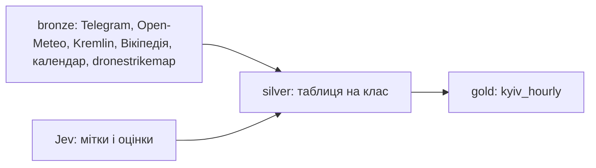

# Архітектура

Прогноз ракетного удару по місту Київ на 3 години вперед щогодини і на ніч о 22:00 ([ADR-0010](adr/0010-night-question.md)), і чи будуть наступні 3 години спокійні з урахуванням дронів ([ADR-0011](adr/0011-quiet-hours.md)); дані з 2026-05-01. Постановка: [METHODOLOGY.md](METHODOLOGY.md). Історія і журнал робіт: [HISTORY.md](HISTORY.md). Чому даним можна довіряти: [VERIFICATION.md](data/VERIFICATION.md).

## Три рівні даних

| Рівень | Де | Що | Документація |
|---|---|---|---|
| bronze | `data/bronze/` | джерела як є, лише дописуємо | [PARSING.md](PARSING.md), `data/bronze/MANIFEST.md` |
| silver | `data/silver/<таблиця>.parquet` | таблиця на клас даних: відфільтровано, UTC, без дублів, з часом доступності | `docs/data/silver/<таблиця>.md` |
| gold | `data/gold/kyiv_hourly.parquet` | одна таблиця для моделі: рядок на годину t, ознаки до t, ціль після t | `docs/data/gold/kyiv_hourly.md` |
| докази | `data/verification/` | результати зовнішньої перевірки мітки і сигналів і аудиту перед моделюванням (у git) | [VERIFICATION.md](data/VERIFICATION.md) |

`data/airalerts.duckdb` містить view на кожен Parquet: `.venv/bin/python -I -m airalerts.db`.



## Код

```
scripts/bronze/                    збирачі bronze (stdlib, python3 -I), tg_backfill.sh
src/airalerts/                     спільне: paths, db, telegram, jev
src/airalerts/silver/<клас>.py     будівник таблиць silver свого класу і features() для gold
src/airalerts/gold/kyiv_hourly.py  gold з features() усіх класів і ціль
src/airalerts/gold/kyiv_nightly.py рядок на ніч для рішення о 22:00, лише з kyiv_hourly
src/airalerts/gold/kyiv_quiet.py   рядок на годину: спокійні 3 години (дрони і ракети), з kyiv_hourly і silver
src/airalerts/modeling/split.py    поділ gold на розробку і тест за часом, фолди walk-forward
src/airalerts/modeling/naive.py    наївна модель; кожна модель пише прогнози в data/predictions/ (не в git)
src/airalerts/modeling/evaluate.py один оцінювач для всіх моделей, таблиця reports/leaderboard.md
src/airalerts/modeling/runner.py   walk-forward для моделей з fit і predict: навчання лише на відомих мітках, прогноз без мітки
src/airalerts/modeling/share_table.py, logistic.py, lgbm.py  три погодинні моделі; опис кожної в docs/models/<назва>.md
src/airalerts/modeling/tasks.py    спільний walk-forward для питань зі своєю таблицею gold: фолди, оцінки, bootstrap
src/airalerts/modeling/nights.py   нічне питання: оцінювач, таблиця reports/nights_leaderboard.md
src/airalerts/modeling/quiet.py    спокійні 3 години: оцінювач, таблиця reports/quiet_leaderboard.md
src/airalerts/modeling/quiet_models/  моделі спокою: baselines.py, linear.py, trees.py; опис у docs/models/quiet_<модуль>.md
src/airalerts/modeling/night_models/  нічні моделі: rules.py, stats.py, ml.py; опис у docs/models/night_<модуль>.md
scripts/analysis/                  описовий аналіз заморожених моделей на тесті (лише друк, нічого не пише)
tests/                             тести на витік: gold погодинний і нічний, поділ, моделі; мірила проти перерахунку в лоб
scripts/verify/                    зовнішня перевірка мітки і сигналів, Workflow агентів, промпти еталонів, аудит gold
```

## Контракт silver і gold

- Кожна таблиця silver має колонку `available_at` (TIMESTAMP, UTC): коли рядок став відомим.
- Модуль `src/airalerts/silver/<клас>.py` має:
  - `main()`: будує свої таблиці silver з bronze;
  - `ASOF`: словник «таблиця: SQL», що повертає таблицю такою, якою її знали перед моментом `{t}` (за замовчуванням `SELECT * FROM <таблиця> WHERE available_at < {t}`; якщо частина рядка стає відомою пізніше, як кінець тривоги, SQL її ховає);
  - `features(con, t_table)`: `con` це DuckDB з view silver під назвами таблиць, `t_table` це назва таблиці з колонкою `t_utc`; повертає `pyarrow.Table` з `t_utc` і колонками gold свого класу, рівно рядок на кожен `t_utc`. Читає silver лише через ці view і бере лише те, що відомо до `t_utc`.
- Ціль `y_strike_3h` рахує `labels(con, t_table)` у `src/airalerts/silver/threat_hourly.py`.
- Тест на витік: для випадкових t зібрати view з `ASOF` (усе, що відомо до t), порахувати `features()` і порівняти з розрахунком на повних даних.

## Таблиці

| Рівень | Таблиця | Модуль | Документ |
|---|---|---|---|
| silver | `kyiv_alerts` | `silver/alerts.py` | [kyiv_alerts.md](data/silver/kyiv_alerts.md) |
| silver | `tg_posts` | `silver/telegram_posts.py` | [tg_posts.md](data/silver/tg_posts.md) |
| silver | `kyiv_threat_hourly`, `kyiv_threat_posts` | `silver/threat_hourly.py` | [kyiv_threat_hourly.md](data/silver/kyiv_threat_hourly.md) |
| silver | `prep_signal_events` | `silver/signals.py` | [prep_signal_events.md](data/silver/prep_signal_events.md) |
| silver | `strike_points`, `strike_days` | `silver/rf_strikes.py` | [rf_strikes.md](data/silver/rf_strikes.md) |
| silver | `weather_runs` | `silver/weather.py` | [weather_runs.md](data/silver/weather_runs.md) |
| silver | `astro_hourly` | `silver/astro.py` | [astro_hourly.md](data/silver/astro_hourly.md) |
| silver | `calendar_dates` | `silver/calendar_dates.py` | [calendar_dates.md](data/silver/calendar_dates.md) |
| silver | `political_events` | `silver/political_events.py` | [political_events.md](data/silver/political_events.md) |
| gold | `kyiv_hourly` | `gold/kyiv_hourly.py` | [kyiv_hourly.md](data/gold/kyiv_hourly.md) |
| gold | `kyiv_nightly` | `gold/kyiv_nightly.py` | [kyiv_nightly.md](data/gold/kyiv_nightly.md) |
| gold | `kyiv_quiet` | `gold/kyiv_quiet.py` | [kyiv_quiet.md](data/gold/kyiv_quiet.md) |

## Як запустити

1. bronze (`python3 -I scripts/bronze/<збирач>`, журнал запусків у `data/bronze/MANIFEST.md`):
   - Telegram: `scripts/bronze/tg_backfill.sh A`, `B`, `C`; довгий канал ділиться на частини (`tg_fetch.py` з `before stop_id`) і зливається `tg_fetch.py merge`; `etryvoga_patch.py` для відбою без старту;
   - погода і астрономія: `wx_backfill.py`, `kyiv_astro.py build data/bronze/astro`;
   - календар і події: `calendar_dates.py`, `kremlin_fetch.py`, `wiki_fetch.py`;
   - удари по РФ і запуски по Україні: `dronestrikemap_fetch.py` (знімок API на кожен запуск).
2. silver: `.venv/bin/python -I -m airalerts.silver.<модуль>` у порядку `alerts`, `telegram_posts`, `threat_hourly classify`, потім `threat_hourly`, `signals`, `rf_strikes`, `weather`, `astro`, `calendar_dates`, `political_events`. Відповіді Jev беруться з кешу, тож повтор безкоштовний.
3. gold: `.venv/bin/python -I -m airalerts.gold.kyiv_hourly`, `.venv/bin/python -I -m airalerts.gold.kyiv_nightly`, `.venv/bin/python -I -m airalerts.gold.kyiv_quiet`, потім `.venv/bin/python -I -m airalerts.db` (view у `data/airalerts.duckdb`).
4. тести на витік (gold і поділ): `.venv/bin/python -I -m unittest discover -s tests -v`; звіт поділу: `.venv/bin/python -I -m airalerts.modeling.split`.
5. моделі: `.venv/bin/python -I -m airalerts.modeling.<naive|share_table|logistic|lgbm>`, потім `.venv/bin/python -I -m airalerts.modeling.evaluate` (лише розробка); тест відкриває `evaluate final`, один раз наприкінці. Нічні моделі: `.venv/bin/python -I -m airalerts.modeling.night_models.<rules|stats|ml>`, потім `.venv/bin/python -I -m airalerts.modeling.nights` (розробка) і `nights final` (тест, один раз). Моделі спокою: `.venv/bin/python -I -m airalerts.modeling.quiet_models.<baselines|linear|trees>`, потім `quiet` і `quiet final` так само. Аналіз тесту: `.venv/bin/python -I scripts/analysis/<hourly_test_breakdown|hourly_nights|quiet_tiers>.py`.
6. зовнішня перевірка (не перебудовує дані): `.venv/bin/python -I scripts/verify/label_check.py`; сигнали за docstring `scripts/verify/signals_check.py`; незалежний перерахунок усього gold: `.venv/bin/python -I scripts/verify/audit_recompute.py`.

## Рішення

- [ADR-0002](adr/0002-data-levels.md): три рівні, Parquet і DuckDB.
- [ADR-0003](adr/0003-jev.md): Jev для мітки удару і оцінок важливості.
- [ADR-0004](adr/0004-rf-strikes-dronestrikemap.md): удари по Росії з dronestrikemap.com, день відомий через 30 год.
- [ADR-0005](adr/0005-political-events-without-world.md): політичні події лише Києва і Росії.
- [ADR-0006](adr/0006-external-verification.md): зовнішня перевірка мітки і сигналів, виправлення мітки вручну.
- [ADR-0007](adr/0007-audit-before-modelling.md): аудит перед моделюванням, 15 годин мітки, пости, переписані після публікації, невідоме як NULL.
- [ADR-0008](adr/0008-time-split.md): поділ на розробку і тест за часом, тест з 2026-08-29, тижневий walk-forward.
- [ADR-0009](adr/0009-three-models.md): три моделі з пошуку агентами і правила проти перенавчання.
- [ADR-0010](adr/0010-night-question.md): нічне питання «чи йти спати в коридор», правила, задані до оцінки, і результат.
- [ADR-0011](adr/0011-quiet-hours.md): спокійні 3 години з дронами, перевірка дронової мітки, правила, задані до оцінки, і результат.
