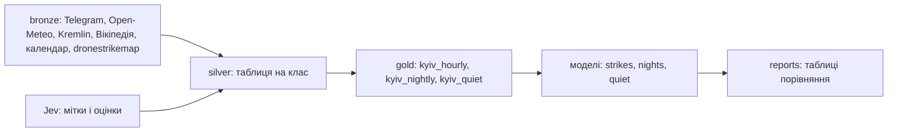

# Архітектура

Прогноз ракетного удару по місту Київ на 3 години вперед щогодини і на ніч о 22:00 ([ADR-0010](adr/0010-night-question.md)), і чи будуть наступні 3 години спокійні з урахуванням дронів ([ADR-0011](adr/0011-quiet-hours.md)); дані з 2026-05-01. Постановка: [METHODOLOGY.md](METHODOLOGY.md). Історія і журнал робіт: [HISTORY.md](HISTORY.md). Чому даним можна довіряти: [VERIFICATION.md](data/VERIFICATION.md).

## Карта репозиторію

| Папка | Що там |
|---|---|
| `src/airalerts/` | код пакета: спільне (`paths`, `db`, `telegram`, `jev`), рівні даних `silver/` і `gold/`, спільна оцінка `evaluation/`, моделі трьох питань `strikes/`, `nights/`, `quiet/` |
| `scripts/` | `bronze/` збирачі сирих даних, `verify/` зовнішня перевірка і аудит, `analysis/` описовий аналіз тесту (лише друк) |
| `tests/` | тести на витік у gold і поділі, тести моделей кожного питання, мірила проти перерахунку в лоб |
| `data/` | `bronze/` і `silver/` (не в git), `gold/` (у git, версія в [DATASET.md](data/DATASET.md)), `predictions/<strikes\|nights\|quiet>/` (не в git), `verification/` (у git) |
| `reports/` | таблиці порівняння моделей `strikes_leaderboard.md`, `nights_leaderboard.md`, `quiet_leaderboard.md`; їх пишуть оцінювачі, вручну не редагувати |
| `docs/` | `ASSIGNMENT`, `METHODOLOGY`, `ARCHITECTURE`, `HISTORY`, `HANDOFF`; `adr/` рішення; `data/` (`PARSING`, `JEV`, `VERIFICATION`, `DATASET`, `silver/`, `gold/`); `strikes/`, `nights/`, `quiet/` опис кожного модуля моделей простими словами |

## Епохи

Кожна епоха це окреме питання до тих самих даних; нове питання з'являлось, коли попереднє давало відповідь, з якою людина нічого не може зробити.

| Епоха | Питання | Рішення | Результат |
|---|---|---|---|
| 0. Дані | bronze, silver, gold з Telegram, тривог, погоди, календарів, ударів по РФ; мітка Jev; зовнішня перевірка й аудит | [ADR-0002](adr/0002-data-levels.md)..[ADR-0007](adr/0007-audit-before-modelling.md), [VERIFICATION.md](data/VERIFICATION.md) | [DATASET.md](data/DATASET.md) |
| 1. Удари (`strikes/`) | ракетний удар по Києву в наступні 3 год, щогодини | [ADR-0008](adr/0008-time-split.md), [ADR-0009](adr/0009-three-models.md) | [strikes_leaderboard.md](../reports/strikes_leaderboard.md): ловить нічні атаки, коли вони вже почались; обидві денні атаки тесту пропущено |
| 2. Ночі (`nights/`) | о 22:00: спати в коридорі чи в кімнаті | [ADR-0010](adr/0010-night-question.md) | [nights_leaderboard.md](../reports/nights_leaderboard.md): о 22:00 не передбачити; тримається лише «ніч після атаки тиха» (23 з 23, тест 6 з 7) |
| 3. Спокій (`quiet/`) | чи будуть наступні 3 год тихими, дрони враховано; прогноз для людини | [ADR-0011](adr/0011-quiet-hours.md), [forecast.md](quiet/forecast.md) | [quiet_leaderboard.md](../reports/quiet_leaderboard.md): тишу не гарантує, але рівні ризику втримались від розробки до тесту; «швидше тихо» правдиве у 83% і там, і там |
| 4. Важливість | які змінні фіналіста спокою важать і що треба парсити для живого продукту | | `docs/quiet/importance.md` |

## Три рівні даних

| Рівень | Де | Що | Документація |
|---|---|---|---|
| bronze | `data/bronze/` | джерела як є, лише дописуємо | [PARSING.md](data/PARSING.md), `data/bronze/MANIFEST.md` |
| silver | `data/silver/<таблиця>.parquet` | таблиця на клас даних: відфільтровано, UTC, без дублів, з часом доступності | `docs/data/silver/<таблиця>.md` |
| gold | `data/gold/<таблиця>.parquet` | таблиця на питання: рядок на момент рішення t, ознаки до t, ціль після t (`kyiv_hourly`, `kyiv_nightly`, `kyiv_quiet`) | `docs/data/gold/<таблиця>.md`, версія: [DATASET.md](data/DATASET.md) |
| докази | `data/verification/` | результати зовнішньої перевірки мітки і сигналів і аудиту перед моделюванням (у git) | [VERIFICATION.md](data/VERIFICATION.md) |

`data/airalerts.duckdb` містить view на кожен Parquet: `.venv/bin/python -I -m airalerts.db`.



## Код

```
src/airalerts/                      спільне: paths.py, db.py, telegram.py, jev.py
src/airalerts/silver/<клас>.py      будівник таблиць silver свого класу і features() для gold
src/airalerts/gold/kyiv_hourly.py   gold з features() усіх класів і ціль удару
src/airalerts/gold/kyiv_nightly.py  рядок на ніч для рішення о 22:00, лише з kyiv_hourly
src/airalerts/gold/kyiv_quiet.py    рядок на годину: спокійні 3 години (дрони і ракети), з kyiv_hourly і silver
src/airalerts/evaluation/           спільна оцінка: split.py поділ за часом і фолди, metrics.py мірила,
                                    walkforward.py walk-forward, bootstrap і вибір фіналіста для nights і quiet
src/airalerts/strikes/              епоха 1, удар у наступні 3 год: naive.py, share_table.py, logistic.py, lgbm.py;
                                    runner.py навчання лише на відомих мітках; score.py оцінювач, reports/strikes_leaderboard.md
src/airalerts/nights/               епоха 2, ніч о 22:00: rules.py, stats.py, ml.py; score.py, reports/nights_leaderboard.md
src/airalerts/quiet/                епоха 3, спокійні 3 год: baselines.py, linear.py, trees.py; score.py, reports/quiet_leaderboard.md;
                                    forecast.py прогноз для людини: тихо чи ні, ймовірність, ризик, причини
scripts/bronze/                     збирачі bronze (stdlib, python3 -I), tg_backfill.sh
scripts/verify/                     зовнішня перевірка мітки і сигналів, Workflow агентів, промпти еталонів, аудит gold
scripts/analysis/                   аналіз заморожених моделей на тесті, лише друк: strikes_test_breakdown, strikes_by_night,
                                    quiet_tiers, quiet_forecast_check, quiet_forecast_value
tests/                              test_gold_hourly, test_split, test_strikes*, test_nights*, test_quiet*
```

Кожна модель пише прогнози в `data/predictions/<strikes|nights|quiet>/` (не в git), оцінювач свого питання читає їх і рахує всім однакові мірила. Опис кожного модуля моделей: `docs/<strikes|nights|quiet>/<модуль>.md`.

## Контракт silver і gold

- Кожна таблиця silver має колонку `available_at` (TIMESTAMP, UTC): коли рядок став відомим.
- Модуль `src/airalerts/silver/<клас>.py` має:
  - `main()`: будує свої таблиці silver з bronze;
  - `ASOF`: словник «таблиця: SQL», що повертає таблицю такою, якою її знали перед моментом `{t}` (за замовчуванням `SELECT * FROM <таблиця> WHERE available_at < {t}`; якщо частина рядка стає відомою пізніше, як кінець тривоги, SQL її ховає);
  - `features(con, t_table)`: `con` це DuckDB з view silver під назвами таблиць, `t_table` це назва таблиці з колонкою `t_utc`; повертає `pyarrow.Table` з `t_utc` і колонками gold свого класу, рівно рядок на кожен `t_utc`. Читає silver лише через ці view і бере лише те, що відомо до `t_utc`.
- Ціль `y_strike_3h` рахує `labels(con, t_table)` у `src/airalerts/silver/threat_hourly.py`.
- Тест на витік: для випадкових t зібрати view з `ASOF` (усе, що відомо до t), порахувати `features()` і порівняти з розрахунком на повних даних.

## Таблиці

| Рівень | Таблиця | Модуль | Документ |
|---|---|---|---|
| silver | `kyiv_alerts` | `silver/alerts.py` | [kyiv_alerts.md](data/silver/kyiv_alerts.md) |
| silver | `tg_posts` | `silver/telegram_posts.py` | [tg_posts.md](data/silver/tg_posts.md) |
| silver | `kyiv_threat_hourly`, `kyiv_threat_posts` | `silver/threat_hourly.py` | [kyiv_threat_hourly.md](data/silver/kyiv_threat_hourly.md) |
| silver | `prep_signal_events` | `silver/signals.py` | [prep_signal_events.md](data/silver/prep_signal_events.md) |
| silver | `strike_points`, `strike_days` | `silver/rf_strikes.py` | [rf_strikes.md](data/silver/rf_strikes.md) |
| silver | `weather_runs` | `silver/weather.py` | [weather_runs.md](data/silver/weather_runs.md) |
| silver | `astro_hourly` | `silver/astro.py` | [astro_hourly.md](data/silver/astro_hourly.md) |
| silver | `calendar_dates` | `silver/calendar_dates.py` | [calendar_dates.md](data/silver/calendar_dates.md) |
| silver | `political_events` | `silver/political_events.py` | [political_events.md](data/silver/political_events.md) |
| gold | `kyiv_hourly` | `gold/kyiv_hourly.py` | [kyiv_hourly.md](data/gold/kyiv_hourly.md) |
| gold | `kyiv_nightly` | `gold/kyiv_nightly.py` | [kyiv_nightly.md](data/gold/kyiv_nightly.md) |
| gold | `kyiv_quiet` | `gold/kyiv_quiet.py` | [kyiv_quiet.md](data/gold/kyiv_quiet.md) |

## Як запустити

Усі команди з кореня репозиторію.

1. bronze (`python3 -I scripts/bronze/<збирач>`, журнал запусків у `data/bronze/MANIFEST.md`):
   - Telegram: `scripts/bronze/tg_backfill.sh A`, `B`, `C`; довгий канал ділиться на частини (`tg_fetch.py` з `before stop_id`) і зливається `tg_fetch.py merge`; `etryvoga_patch.py` для відбою без старту;
   - погода і астрономія: `wx_backfill.py`, `kyiv_astro.py build data/bronze/astro`;
   - календар і події: `calendar_dates.py`, `kremlin_fetch.py`, `wiki_fetch.py`;
   - удари по РФ і запуски по Україні: `dronestrikemap_fetch.py` (знімок API на кожен запуск).
2. silver: `.venv/bin/python -I -m airalerts.silver.<модуль>` у порядку `alerts`, `telegram_posts`, `threat_hourly classify`, потім `threat_hourly`, `signals`, `rf_strikes`, `weather`, `astro`, `calendar_dates`, `political_events`. Відповіді Jev беруться з кешу, тож повтор безкоштовний.
3. gold: `.venv/bin/python -I -m airalerts.gold.kyiv_hourly`, `.venv/bin/python -I -m airalerts.gold.kyiv_nightly`, `.venv/bin/python -I -m airalerts.gold.kyiv_quiet`, потім `.venv/bin/python -I -m airalerts.db` (view у `data/airalerts.duckdb`). Контрольні суми файлів gold: [DATASET.md](data/DATASET.md).
4. тести: `choom -n 500 -- .venv/bin/python -I -m unittest discover -s tests`; звіт поділу на розробку і тест: `.venv/bin/python -I -m airalerts.evaluation.split`.
5. моделі й оцінка, однаково для кожного питання:

   | Питання | Моделі (пишуть прогнози) | Оцінювач |
   |---|---|---|
   | удари | `.venv/bin/python -I -m airalerts.strikes.<naive\|share_table\|logistic\|lgbm>` | `.venv/bin/python -I -m airalerts.strikes.score [final \| check NAME]` |
   | ночі | `.venv/bin/python -I -m airalerts.nights.<rules\|stats\|ml>` | `.venv/bin/python -I -m airalerts.nights.score [final \| check NAME]` |
   | спокій | `.venv/bin/python -I -m airalerts.quiet.<baselines\|linear\|trees>` | `.venv/bin/python -I -m airalerts.quiet.score [final \| check NAME]` |

   Без аргументу оцінювач рахує лише розробку і переписує свою таблицю в `reports/`; `check NAME` порівнює одну модель з опорною на розробці; `final` відкриває тест. Тест кожного питання вже відкрито один раз, і таблиці в `reports/` згенеровано з `final`: запуск без `final` замінить їх таблицею лише розробки.
6. прогноз для людини: `.venv/bin/python -I -m airalerts.quiet.forecast ["YYYY-MM-DD HH:MM" | day YYYY-MM-DD]` (без аргументу: остання година gold).
7. аналіз тесту (лише друк): `.venv/bin/python -I scripts/analysis/<strikes_test_breakdown|strikes_by_night|quiet_tiers|quiet_forecast_check|quiet_forecast_value>.py`.
8. зовнішня перевірка (не перебудовує дані): `.venv/bin/python -I scripts/verify/label_check.py`; сигнали за docstring `scripts/verify/signals_check.py`; незалежний перерахунок усього gold: `.venv/bin/python -I scripts/verify/audit_recompute.py`.

## Рішення

- [ADR-0002](adr/0002-data-levels.md): три рівні, Parquet і DuckDB.
- [ADR-0003](adr/0003-jev.md): Jev для мітки удару і оцінок важливості.
- [ADR-0004](adr/0004-rf-strikes-dronestrikemap.md): удари по Росії з dronestrikemap.com, день відомий через 30 год.
- [ADR-0005](adr/0005-political-events-without-world.md): політичні події лише Києва і Росії.
- [ADR-0006](adr/0006-external-verification.md): зовнішня перевірка мітки і сигналів, виправлення мітки вручну.
- [ADR-0007](adr/0007-audit-before-modelling.md): аудит перед моделюванням, 15 годин мітки, пости, переписані після публікації, невідоме як NULL.
- [ADR-0008](adr/0008-time-split.md): поділ на розробку і тест за часом, тест з 2026-08-29, тижневий walk-forward.
- [ADR-0009](adr/0009-three-models.md): три моделі з пошуку агентами і правила проти перенавчання.
- [ADR-0010](adr/0010-night-question.md): нічне питання «чи йти спати в коридор», правила, задані до оцінки, і результат.
- [ADR-0011](adr/0011-quiet-hours.md): спокійні 3 години з дронами, перевірка дронової мітки, правила, задані до оцінки, і результат.
